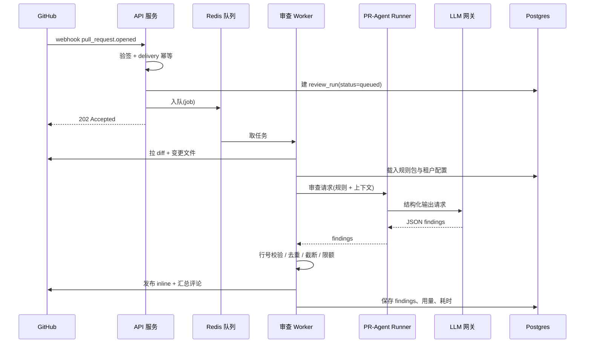
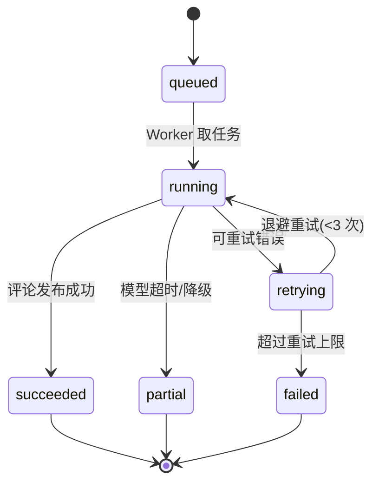
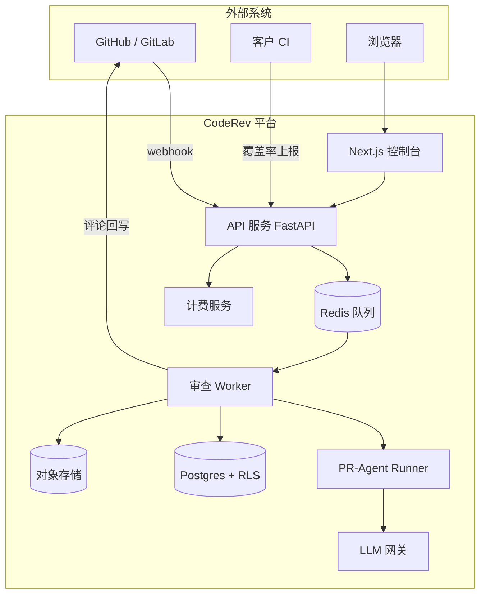

# CodeRev 产品需求文档（PRD）v0.1

> **一句话**：给 10–200 人研发团队的「PR 审查 + 测试闭环」工作流 SaaS —— 装一个 GitHub App，PR 一开就出风险摘要、规则命中、测试建议，并把「发现缺测试」接到「补测试 + 增量覆盖率验证」。
>
> 状态：初稿，待评审 ｜ 日期：2026-11-08 ｜ 版本：v0.1

---

## 0. 文档说明

### 0.1 版本记录

| 版本 | 日期 | 变更 | 作者 |
|---|---|---|---|
| v0.1 | 2026-11-08 | 首版：定位、范围、功能需求、技术方案、License 策略、商业化、里程碑 | 待填 |

### 0.2 读者与用途

- **研发**：第 6、7、8、9 章是可实施的需求与方案基线。
- **创始人 / 投资人**：第 1、2、4、11、12 章是商业逻辑与验证路径。
- **法务 / 安全**：第 8.3、8.4、10 章是数据与 License 边界。

### 0.3 术语表

| 术语 | 含义 |
|---|---|
| CR / PR | Code Review / Pull Request，本文混用，统一指合并请求审查 |
| 规则包（Rule Pack） | 一组可版本化、可启停的审查规则集合，按语言/框架/行业组织 |
| 审查意见（Finding） | 一条带 `file:line + rule_id + 严重级别 + 置信度` 的具体问题 |
| 增量覆盖率（Patch Coverage） | 只看本次 PR 新增/修改代码行的覆盖率，区别于全仓覆盖率 |
| 采纳率 | 被用户标记「有用」的意见数 ÷ 总意见数 |
| 误报率 | 被标记「不准确」的意见数 ÷ 总意见数 |
| BYOK | Bring Your Own Key，客户自带模型 API Key，用自己账号计费 |
| TTFV | Time To First Value，从安装到收到第一条有效审查意见的耗时 |

---

## 1. 背景与机会

### 1.1 问题：CR 是研发流程里最没被工具化的环节

1. **审查是瓶颈，不是环节**。10–50 人团队通常只有 2–3 个能拍板的 reviewer，一个 PR 从提交到有人认真看，经验值要 4–24 小时；大 PR 更久，于是团队被迫「先合再修」。
2. **质量取决于谁有空**。团队规范散落在 Confluence、口头约定、历史 PR 评论里；新人 review 只看格式，老人 review 只看架构，同一个仓库两套标准。
3. **机械问题吃掉注意力**。空指针、日志泄漏密钥、事务里发 HTTP、异常被吞、N+1 查询——这类问题占 reviewer 时间的大头，却最适合机器做。
4. **测试永远排在后面**。PR 里新增的分支没人补测，团队覆盖率「只在存量上涨」；等到线上出事才发现关键路径没测试。
5. **交付质量无法被外部验证**。外包场景下，甲方只能验收「能跑」，无法验收「可维护」；缺一份可交付、可对比的质量报告。

> 结论：团队缺的不是「一个会评论代码的机器人」，而是**一套把团队规范变成可执行检查、并且能验证检查是否有效的流程**。

### 1.2 为什么是现在

- **底座成熟**：PR-Agent 在 2026-04 由 Qodo 移交社区（The-PR-Agent 组织），回归宽松许可，可完全自托管、支持多模型；这是唯一一个「能直接拿来当审查引擎」的开源项目。
- **模型能力到位**：长上下文 + 结构化输出（JSON Schema）+ 函数调用，让「按规则审查 + 输出可解析结果」从 demo 变成工程。
- **分发成本低**：GitHub Marketplace / GitLab 应用市场是天然的 B 端流量入口，安装即试用。
- **买方认知已建立**：CodeRabbit、Qodo、Graphite 已经教育了市场「AI 可以审 PR」，剩下的是「谁的误报低、谁的规则能沉淀、谁能闭环」。

### 1.3 竞争格局

| 产品 | 形态 | 平台 | 规则可配 | 误报反馈 | 测试闭环 | 国内平台 | 私有化 |
|---|---|---|---|---|---|---|---|
| CodeRabbit | 商业 SaaS | GitHub/GitLab | 中（配置文件） | 弱 | 弱 | 无 | 有企业版 |
| Qodo Merge | 商业 SaaS | GitHub/GitLab/Bitbucket | 强 | 中 | 中（Qodo Cover 商业版） | 无 | 有 |
| Graphite Diamond | 商业 SaaS | GitHub | 弱 | 弱 | 无 | 无 | 无 |
| PR-Agent（自建） | 开源自托管 | 多平台 | 中（YAML） | 无 | 弱（/test 仅建议） | 无 | 就是自建 |
| **CodeRev** | SaaS + 私有化 | GitHub 起步 → GitLab/国内平台 | **强（模板库 + 自定义）** | **强（闭环沉淀）** | **强（审查→补测→验证）** | **V2 支持** | **Enterprise** |

> 数据以各产品 2026-11 官网/仓库为准，仅作定位参考，不作为采购依据。

**三个空位**（也是我们的切入点）：

1. **规则不会写**。开源工具给了配置文件，但多数团队写不出有效规则；缺的是「开箱即用的规则模板 + 命中统计 + 迭代建议」。
2. **审查和测试是两件事**。PR-Agent 的 `/test` 只给建议，qodo-cover 只做覆盖率，两者不联动；「审查发现缺测试 → 生成测试 → 覆盖率验证」这条链没人做完整。
3. **国内落地缺位**。Gitee / Coding / 自建 GitLab / Gerrit、企微钉钉飞书、数据不出内网、国产模型——海外产品基本不覆盖。

### 1.4 我们的三个判断

1. **这是工作流产品，不是模型产品**。模型会趋同，壁垒在规则库、误报数据、集成深度和交付方式。
2. **误报治理是留存杠杆**。用户不会因为「少审出 10% 问题」流失，一定会因为「每天 5 条废话」流失。
3. **测试闭环是唯一能把审查从成本项变成质量资产的路径**。审查说「这里没测」很容易，难的是让团队真的补上并有数据证明。

---

## 2. 产品定位

### 2.1 一句话定位

> 面向 10–200 人研发团队的 AI 代码审查工作流：把团队规范变成可执行规则，把审查意见变成可追溯结论，把「缺测试」变成「补测试 + 覆盖率验证」的闭环。

### 2.2 分角色价值主张

| 角色 | 他要什么 | 我们给什么 |
|---|---|---|
| 技术负责人 / EM | 审查不依赖个人、质量可度量 | 规则统一、评审 SLA、采纳率/误报率/覆盖率趋势看板 |
| 一线开发 | 别给我添噪音、别挡我合并 | 默认只评论不阻断、可一键「这不是问题」、意见带行号和依据 |
| 外包交付经理 | 能向甲方证明质量 | 按项目导出的质量报告（白标）、增量覆盖率基线对比 |
| 开源维护者 | 过滤 trivial PR | 低价值 PR 自动摘要 + 只在高风险处打扰 |

### 2.3 差异化四支柱

1. **可信（Trust）**：每条意见必须可定位——文件、行号、规则 ID、置信度；定位不到的结论直接丢弃，宁缺毋滥。
2. **可配（Configurable）**：规则模板库（Java/Spring、Go 并发、React/TS、通用安全）+ 自然语言自定义规则 + 严重级别三级策略。
3. **闭环（Closed-loop）**：审查 → 测试建议 → CI 覆盖率上报 → 增量覆盖率校验 → 回流到规则与提示词。
4. **可落地（Deployable）**：GitHub 起步，V2 覆盖 GitLab/Gitee/Coding/Gerrit；SaaS 与私有化双形态；支持国产模型与 BYOK。

### 2.4 反定位（明确不做）

- 不做通用代码补全 / IDE 插件（不与 Copilot、Cursor 正面竞争）。
- 不做「自动改代码并直接提交 PR」（MVP 阶段；V2 再做「生成测试 PR」且默认人工确认）。
- 不做全仓语义索引与跨仓影响分析（V2 评估）。
- 不做代码托管平台本身，只做「审查层」。

---

## 3. 用户与场景

### 3.1 Persona

| | P1 技术负责人（决策者） | P2 外包交付经理（付费方） | P3 开源维护者（种子用户） |
|---|---|---|---|
| 团队规模 | 10–50 人，3–10 个仓库 | 20–200 人，多客户项目并行 | 个人 / 小团队维护热门仓库 |
| 目标 | 交付质量可控、review 不阻塞 | 交付可验收、少返工、能出报告 | 减少噪音、聚焦设计问题 |
| 痛点 | 规范落地靠人盯；不知道 AI 审得准不准 | 甲方只看「能不能跑」；返工成本高 | trivial PR 淹没邮箱 |
| 决策关注 | 误报率、数据安全、集成成本 | 报告可信度、按项目计价 | 免费、可关、不添乱 |
| 成功标准 | 30 天内 PR 平均审查时长下降 | 交付验收一次通过率上升 | 每周节省 2 小时 |

### 3.2 场景故事

**场景 A：周一早上的 6 个积压 PR（P1）**
- Before：6 个 PR 排队，reviewer 逐个看，平均 6 小时响应；两个 PR 因为「事务里发 HTTP」被线上事故倒查发现，而这两处当时没人提。
- After：PR 一开 90 秒内出摘要 + 3 条带行号的意见；reviewer 直接看「高风险 2 文件」，20 分钟完成审查；事故类问题被 `java-spring/transaction-boundary` 规则在第 3 次提交时就拦下来（警告级，不阻断）。

**场景 B：外包交付验收（P2）**
- Before：甲方验收靠演示 + 抽检代码，出问题后按人天扯皮。
- After：每个交付迭代自动生成《代码质量报告》：增量覆盖率 78%、高危问题 0、规则命中趋势、未覆盖的关键路径清单；报告可白标为甲方品牌，作为验收附件。

**场景 C：开源维护者的噪音（P3）**
- Before：每周 40 个 PR，30 个是文档/依赖升级，真正需要看的 5 个被淹没。
- After：低风险 PR 自动归类并给出一句话结论；高风险 PR 才 @ 维护者；维护者只处理「设计层」评论。

### 3.3 首次价值路径（目标 ≤ 5 分钟）

安装 GitHub App → 选择仓库 → 选规则包（默认推荐）→ 打开一个已有 PR 手动触发 `/review` → 90 秒内看到第一条评论。

> 设计原则：**不要求先配完再试用**。默认配置必须能直接跑出结果，配置是「调优」而不是「门槛」。

---

## 4. 目标与指标

### 4.1 北极星指标

**周活跃审查 PR 数（Weekly Reviewed PRs）** = 周内产生过至少一条有效评论的 PR 数。
它同时反映「装了多少仓库」「仓库里 PR 多不多」「评论是否真的发出去了」，比 DAU 更贴近价值。

### 4.2 指标定义与目标

| 指标 | 定义 | MVP 目标 | 90 天目标 |
|---|---|---|---|
| 激活率 | 安装后 24h 内产生首条评论的租户占比 | ≥ 60% | ≥ 75% |
| TTFV | 安装 → 首条评论（p50） | ≤ 10 分钟 | ≤ 5 分钟 |
| 单 PR 意见数 | 平均每 PR 发出的意见条数 | ≤ 6 | ≤ 5 |
| 采纳率 | 「有用」÷ 总意见 | ≥ 30% | ≥ 45% |
| 误报率 | 「不准确」÷ 总意见 | ≤ 20% | ≤ 12% |
| 覆盖率增量 | 接入 30 天后，周增量覆盖率中位数变化 | 基线采集 | +15pt |
| 试用转化 | 14 天试用 → 付费 | ≥ 15% | ≥ 25% |
| 月流失 | 付费租户月 churn | — | ≤ 5% |
| LLM 成本占比 | 模型成本 ÷ 收入 | ≤ 25% | ≤ 20% |
| 审查延迟 | webhook → 首条评论 p95 | ≤ 120s | ≤ 90s |

### 4.3 护栏指标（变差就回滚）

- **噪音**：单 PR 意见 > 10 条的比例 < 5%。
- **误伤**：被用户删除/折叠的评论占比 < 10%。
- **稳定性**：审查任务失败率 < 2%；重复评论率 < 0.5%。
- **成本**：单 PR 成本 > $0.15 的租户占比 < 3%。

### 4.4 阶段性目标

- **MVP（第 4 周末）**：5–10 个种子团队，跑满 200 个真实 PR，拿到误报率与采纳率基线。
- **第 8 周**：付费转化 ≥ 15%，单 PR 成本 ≤ $0.05。
- **第 12 周**：验证「审查 → 补测」闭环是否真的提升覆盖率（对照实验）。

---

## 5. 范围与优先级

### 5.1 版本范围

| 能力 | MVP（4 周） | V1（+6–8 周） | V2（+3 个月） |
|---|---|---|---|
| 平台 | GitHub | GitLab | Gitee / Coding / Gerrit |
| 语言/框架模板 | Java/Spring、通用安全（必选）；Go、React/TS（选配） | 全部 4 套打磨 | 行业包（支付/金融） |
| PR 审查 | 摘要 + 意见清单（inline 评论） | Check Run + 阻断策略 | 跨文件/跨仓影响 |
| 反馈闭环 | 有用/误报 + 原因 | 规则级抑制 + 团队偏好 | 自动调权重 |
| 测试建议 | 缺失测试识别 + 测试点建议 | 生成测试代码片段 | 自动生成测试 PR |
| 覆盖率 | 上报 API + 增量覆盖率评论 | 阈值门禁 + 未覆盖行标注 | 历史趋势与回归预警 |
| 报表 | 基础仪表盘 + CSV | PDF 白标报告 | 客户级多项目汇总 |
| 计费 | Stripe + 试用 + 额度 | 国内支付 + 年付 | 用量阶梯 + 发票 |
| 私有化 | 不做 | 方案设计 | 交付 |

### 5.2 明确不做（MVP）

- 自动修复并提交代码、自动合并、自动回滚。
- 服务端执行客户测试（隔离、成本、License 三重原因）。
- SSO / SCIM / 精细 RBAC（只做 Owner / Admin / Member / Viewer）。
- 全语言支持（不做「什么语言都能审」的承诺）。

### 5.3 前置依赖

- GitHub App 注册与审核（需隐私政策、数据删除说明、最小权限）。
- 至少 2 家模型供应商账号（主 + 备），以及国内模型备选。
- 支付通道（Stripe 测试账号；国内支付需企业主体）。
- 一批真实 PR 用于评测集（可从 GitHub 公开仓库采集，注意许可与隐私）。

---

## 6. 功能需求

> 每节结构：**目标 → 用户故事 → 关键规则 → 验收标准**。验收标准尽量可测。

### 6.1 接入与租户管理

**目标**：3 步完成接入，不写配置也能出结果。

**用户故事**
- 作为管理员，我安装 GitHub App 后可以选择哪些仓库启用审查。
- 作为管理员，我可以邀请成员并分配角色。
- 作为成员，我能看到本租户的审查历史。

**关键规则**
- GitHub App 权限最小化：`contents: read`、`pull_requests: write`、`checks: write`（V1）、`metadata: read`。
- 安装即创建租户（一个 GitHub 账号/组织对应一个租户），支持一个租户绑定多个 installation（组织 + 个人仓库）。
- 仓库级开关：默认全部关闭，安装后引导选择；支持「仅审查指定分支」「跳过 draft PR」「跳过 `[skip review]` 标记」。
- 角色：Owner（计费+删除）、Admin（配置）、Member（反馈）、Viewer（只读）。
- 卸载/删除租户：30 天内硬删除数据，提供导出。

**验收标准**
- [ ] 新租户安装 → 选仓库 → 打开 PR → 120 秒内收到评论（无需任何配置）。
- [ ] 未授权仓库不产生任何 API 调用（审计日志可验证）。
- [ ] 成员邀请邮件 1 分钟内送达，角色权限符合上表。

### 6.2 规则中心

**目标**：让不懂 prompt 的 Tech Lead 也能把团队规范变成检查项。

**用户故事**
- 作为 Tech Lead，我从模板库启用「Java/Spring 规范包」，并关掉其中不适用的规则。
- 作为 Tech Lead，我用自然语言新增一条团队规则，并附上正反例。
- 作为 Admin，我把某条规则设为「阻断」，让它在 PR 上变红。

**规则模型**

```yaml
id: java-spring/transaction-boundary
name: 事务边界内不得发起外部 HTTP 调用
language: java
applies_to: ["src/main/java/**/*.java"]
severity: warning          # suggestion | warning | blocker
intent: |
  在 @Transactional 方法内同步调用外部 HTTP/RPC 会拉长事务持有时间，
  可能导致连接池耗尽与锁等待。应移到事务外或改为异步。
examples:
  bad: |
    @Transactional
    public void pay(Order o) { http.post("/notify", o); repo.save(o); }
  good: |
    public void pay(Order o) { repo.save(o); }
    @TransactionalEventListener public void notify(Order o) { http.post(...); }
enabled_by_default: true
```

- **规则包**：`core/java-spring`、`core/security`、`core/go`、`core/react-ts`；每个包带版本号，升级需租户确认（避免行为突变）。
- **严重级别**：`suggestion`（蓝色建议）、`warning`（黄色，默认）、`blocker`（红色，V1 起支持 Check Run 失败）。
- **作用域**：路径 glob + 文件类型 + 分支名规则。
- **自定义规则**：自然语言 + 正例/反例（few-shot），保存后先在「试跑」里对最近 5 个 PR 回放，确认误报再启用。

**验收标准**
- [ ] 启用/停用规则后，下个 PR 的评论中不再出现该类意见。
- [ ] 自定义规则保存时做 schema 校验，缺正反例时提示。
- [ ] 规则包升级不改变已停用规则的状态。

### 6.3 PR 审查引擎

**目标**：90 秒内给出「能直接拿去改」的结论。

**触发**
- `pull_request.opened` / `reopened` / `ready_for_review` / `synchronize`（节流：同一 PR 5 分钟内只跑一次，取最新 commit）。
- 手动：评论 `/review`、`/describe`、`/test`（兼容 PR-Agent 习惯）。
- 跳过：draft、标题含 `[skip review]`、变更行数 > 1500（改为「仅审高风险文件」并在评论中说明）。

**输入装配**
- PR diff（unified）+ 变更文件全文（超长按函数边界截断）+ 相关测试文件（同名/同目录）+ 变更文件的 import 依赖摘要。
- **MVP 不做全仓索引**：成本与延迟不可控，且 80% 的问题在变更文件内可见。

**输出结构**

1. **变更概览**（3 行内）：这个 PR 改了什么、影响面、是否建议拆分。
2. **风险结论**：`低 / 中 / 高` + 一句话理由。
3. **问题清单**（按严重级别排序，最多 8 条）：每条含 文件:行号、规则 ID、问题描述、修复建议（给 diff 片段）、置信度。
4. **测试缺口**（见 6.5）。
5. **页脚**：本次审查用了哪些规则、耗时、反馈入口。

**评论策略**
- 优先 **inline comment**（挂到具体行）；跨文件/架构类问题走 **汇总评论**。
- 每个 PR 最多 1 条汇总 + 8 条 inline；超出按严重级别截断，并在汇总里注明「另有 N 条低优先级未展示」。
- **幂等**：指纹 `(repo, pr, path, line_start, rule_id)`；重复触发时更新原评论而不是新增。
- **force-push 处理**：旧 commit 的 inline 评论折叠为「已过期」，新评论只针对新增/修改行。
- 评论统一带隐藏标记 `<!-- coderev:run_id=... -->`，用于后续清理与统计。

**降级**
- 模型超时（60s）→ 只发摘要，标注「深度审查未完成」。
- 模型不可用 → 队列重试 3 次（指数退避），仍失败则发「审查暂不可用」并告警，绝不静默。

**验收标准**
- [ ] 400 行以内变更的 PR，p95 ≤ 90 秒出首条评论。
- [ ] 同一次 push 重复触发不产生重复评论（幂等测试）。
- [ ] 所有 inline 评论的 `line` 必须存在于 diff 中；不存在则该条转汇总或丢弃。
- [ ] 单 PR 意见数超过 8 条时按严重级别截断，且汇总中说明。

### 6.4 反馈闭环

**目标**：把「这条不对」变成产品能力，而不是客服工单。

**用户故事**
- 作为 reviewer，我可以对任一意见点「有用 / 不准确」，并选择原因。
- 作为 Admin，我能看到本团队 Top 误报规则，并一键降低其权重或停用。

**关键规则**
- 反馈原因枚举：`不准确`、`不适用本团队`、`重复`、`太啰嗦`、`建议有误`。
- 反馈落库到 `feedback` 表，按 `rule_id` 聚合；同一规则在同一租户连续 5 次「不准确」→ 自动降级为 `suggestion` 并通知 Admin。
- 反馈不影响历史评论，只影响后续审查（可预期）。
- 外部（GitHub 👍/👎 reaction）也计入，权重低于站内反馈。

**验收标准**
- [ ] 点击反馈 1 秒内落库，仪表盘 5 分钟内可见。
- [ ] 规则连续误报阈值触发后，下一次审查中该规则不再输出 `warning`。
- [ ] 每条反馈可在后台追溯到具体 run/finding/用户。

### 6.5 测试建议（Test Advisor）

**目标**：让团队看见「哪些新增逻辑没被测、接下来该写什么」，而不是给一堆跑不起来的代码。

**用户故事**
- 作为开发，我在 PR 评论里看到「本次新增 3 个分支未被覆盖，建议补 4 个用例」。
- 作为 Tech Lead，我能把「缺测试」设为 warning，让它在合并前必须处理。

**识别逻辑**
1. 从 diff 中提取新增/修改的方法与分支（函数级 AST + 行变更）。
2. 匹配仓库内同包/同目录测试文件，判断是否存在对应测试方法。
3. 若有覆盖率上报，看新增行是否被覆盖；无上报则退化为静态判断（标注「未验证」）。
4. 对无测试的方法，按风险排序：涉及资金/权限/并发/外部 IO 的优先。

**输出**
- 测试点清单（≤ 6 条），每条：`文件:函数` + 场景（Given/When/Then）+ 优先级 + 建议框架与 mock 点。
- 可选「生成测试代码」折叠块（V1），默认不展开、不提交。
- 明确标注置信度与「未能验证」的原因。

**关键规则**
- 不自动提交测试代码，不修改仓库。
- 生成内容必须通过语法检查（Java 用 javac 试编译）才能展示，否则只给测试点。
- Java 默认 JUnit 5 + Mockito；TS 默认 Vitest；Go 默认 `testing` + testify（可配）。

**验收标准**
- [ ] 对一个新增 service 方法且无测试的 PR，能稳定给出 ≥ 2 条可执行测试点。
- [ ] 对已有完整测试的 PR，不产生测试建议（误报控制）。
- [ ] 建议中引用的类名/方法名必须存在于仓库（可用符号校验）。

### 6.6 增量覆盖率闭环

**目标**：把「测试建议」变成可验证的数字，且不在服务端跑客户代码。

**用户故事**
- 作为开发，我在 PR 里看到「本次新增 142 行，已覆盖 88 行，增量覆盖率 62%（团队阈值 80%）」。
- 作为 Admin，我配置覆盖率阈值和是否阻断。

**上报 API**

```
POST /api/v1/coverage
Authorization: Bearer <repo_token>
Content-Type: multipart/form-data

repo_full_name=acme/order-service
commit_sha=<head>
base_sha=<optional, 缺省用 merge-base 推算>
format=jacoco|lcov|cobertura|go-cover
file=@jacoco.xml.gz
```

- 返回 `{ report_id, status: "accepted" }`，异步解析。
- 认证：仓库级 token（在控制台生成，可轮换），避免客户在 CI 里放账号密码。
- 幂等：`(repo, commit_sha, format)` 唯一，重复上传覆盖。

**计算**
1. 解析覆盖率文件 → 行级覆盖集合（file → covered_lines）。
2. 取 PR base/head 的 diff → 新增或修改的行（added lines）。
3. 增量覆盖率 = `covered ∩ added / added`，排除生成代码、测试代码、空行、注释（可配）。
4. 与上次基线对比，给出趋势。

**展示**
- PR 汇总评论中追加一段覆盖率卡片（表格 + 徽章）。
- 未达标时：默认 `warning`（不阻断）；V1 支持 Check Run `neutral/failure`。
- 明细页可视化「未覆盖的新增代码行」。

**验收标准**
- [ ] JaCoCo 与 lcov 两种格式解析正确（用真实样本校验，误差 0）。
- [ ] 文件重命名/移动时能通过相似度匹配，不因 rename 判为全未覆盖。
- [ ] 未上报覆盖率的 PR 不展示覆盖率卡片（不伪造数据）。
- [ ] 上报接口 p95 处理 ≤ 30 秒（10 MB 以内文件）。

### 6.7 报告与仪表盘

**目标**：给 Tech Lead 一个「这周质量怎么样」的答案，给外包一个「能发给甲方」的文件。

**页面**
1. **总览**：审查 PR 数、采纳率、误报率、平均意见数、增量覆盖率、PR 平均审查时长。
2. **规则命中**：Top 10 命中规则、按严重级别分布、误报 Top 5。
3. **仓库维度**：每个仓库的趋势与对比。
4. **报告导出**：CSV（明细）、PDF（周报/项目报告）。

**验收标准**
- [ ] 所有指标口径与第 4 章一致，页面可下钻到具体 PR。
- [ ] PDF 导出 30 秒内完成，含图表与统计口径说明。
- [ ] 数据延迟 ≤ 5 分钟（流式聚合计入）。

### 6.8 计费、套餐与额度

| 套餐 | 价格 | 仓库数 | PR 额度/月 | 包含 |
|---|---|---|---|---|
| Trial | 免费 14 天 | 3 | 200 | 全部模板、覆盖率闭环 |
| Starter | $29 / ¥199 月 | 3 | 300 | 基础模板、邮件支持 |
| Team | $99 / ¥699 月 | 10 | 1500 | 全部模板、IM 通知、报告导出 |
| Growth | $249 / ¥1699 月 | 30 | 5000 | 白标报告、优先支持 |
| Enterprise | 定制 | 不限 | 定制 | 私有化、BYOK、SSO、审计 |

**额度规则**
- 计费单位：一次审查（run）。同一 PR 在 5 分钟内的多次 push 合并计 1 次。
- 失败/降级的 run 不计费。
- 超额：软限制——继续服务并提示，超出部分按 $0.08/PR 计；硬限制可在后台开启。
- 年付 8 折；开源项目免费（需公开仓库 + 署名）；BYOK 客户减免 20%。

**验收标准**
- [ ] 试用到期前 3 天、1 天各发一次提醒。
- [ ] 额度用量与账单可对账（账单明细可导出）。
- [ ] 降级/失败不扣额度（有对账测试）。

### 6.9 通知与集成

- **MVP**：邮件（周报、额度告警、连续误报提醒）。
- **V1**：企业微信 / 钉钉 / 飞书 / Slack webhook；PR 高风险时推送摘要卡片。
- **V1**：CI 集成文档（GitHub Actions、GitLab CI 模板）。
- 通知频率限制：同一仓库每 10 分钟最多 1 条汇总。

### 6.10 运营后台（内部）

- 租户列表：套餐、用量、成本、健康度（失败率、误报率）。
- 审查任务排查：按 PR 查 run 日志、prompt、token 消耗、耗时。
- 误报复核队列：抽样人工标注，用于更新评测集。
- 规则命中监控：某规则误报突增时自动下架并告警。

---

## 7. 关键流程

### 7.1 安装与首个 PR

1. 用户在 GitHub Marketplace / 官网点击「Install」。
2. GitHub 回调 → 创建租户 → 拉取可安装仓库列表。
3. 用户选择仓库（默认全不选，提供「推荐开启」）。
4. 系统推荐规则包（按仓库主语言自动匹配）。
5. 引导页：「打开一个已有 PR，输入 `/review` 试试」。
6. 90 秒内出评论 → 引导页标记「首个价值达成」，弹出反馈引导。

### 7.2 一次审查的完整时序



### 7.3 审查任务状态机



### 7.4 覆盖率上报流程

1. 客户 CI 在测试步骤产出 `jacoco.xml` / `lcov.info` / `coverage.out`。
2. CI 调 `POST /api/v1/coverage`（仓库 token）。
3. 服务端解析 → 存对象存储 → 计算增量覆盖率。
4. 回写 PR 评论（更新同一条覆盖率卡片）。
5. 仪表盘累计趋势。

---

## 8. 非功能需求

### 8.1 性能

| 场景 | 指标 | 目标 |
|---|---|---|
| webhook 接收 | p99 | ≤ 300ms |
| 审查首条评论 | p95（≤400 行） | ≤ 90s |
| 审查首条评论 | p95（≤1500 行） | ≤ 180s |
| 控制台页面 | LCP | ≤ 2.5s |
| 覆盖率解析 | p95（10MB） | ≤ 30s |

### 8.2 可靠性

- **投递语义**：至少一次 + 幂等（`delivery_id` 唯一键），重复投递不产生重复评论。
- **重试**：LLM 错误分类——`rate_limit` / `timeout` / `5xx` 重试 3 次（2s/8s/30s 退避）；`4xx` 不重试。
- **死信**：超过重试进 DLQ，告警并可在后台重放。
- **降级**：模型不可用时发摘要 + 提示，不静默失败。
- **可用性**：MVP 99.5%；单区域部署，RPO 24h / RTO 4h。

### 8.3 安全与隐私

| 项 | 要求 |
|---|---|
| 权限 | GitHub App 最小权限；不申请 `contents: write` |
| 代码存储 | 默认不持久化源码；仅在任务内存与临时目录；对象存储保留 ≤ 7 天（可配 0） |
| 脱敏 | 入库前扫描密钥/token 并替换；日志不打印源码全文 |
| 隔离 | Postgres RLS + `tenant_id`；对象存储按租户前缀；Worker 不跨租户复用上下文 |
| 传输 | 全链路 TLS；webhook 验签（HMAC） |
| 访问 | 控制台 SSO（V1）；后台操作审计 180 天 |
| 删除 | 租户删除后 30 天内硬删除，提供删除证明 |

### 8.4 合规

- 签署 DPA（数据处理协议）；承诺**不使用客户代码训练模型**。
- 支持数据区域选择（国内 / 海外），满足跨境数据要求。
- 隐私政策明确：收集哪些数据、保留多久、如何删除（GitHub App 审核必需）。
- 开源合规见第 10 章。

### 8.5 成本控制

- **模型分层**：小模型做文件风险分诊（每文件 1 次短调用），大模型只审高风险文件。
- **缓存**：同 `(repo, head_sha, rule_pack_version)` 结果缓存 24h；相同文件内容哈希命中复用。
- **截断**：单文件上下文 ≤ 8k token，超长按函数边界截断优先保留 diff 附近。
- **预算**：每租户月 LLM 预算，达 80% 通知、100% 降级到小模型。
- **目标**：单 PR 平均成本 ≤ $0.05（详见 11.2）。

### 8.6 可观测性

- 指标：webhook 成功率、队列积压、run 成功率/耗时、token 用量、成本、评论数、误报率。
- 链路：OpenTelemetry 贯穿 API → Queue → Worker → LLM。
- 告警：失败率 > 2%、队列积压 > 100、单租户成本突增 3 倍。

---

## 9. 技术方案概要

### 9.1 架构



| 组件 | 职责 | 选型理由 |
|---|---|---|
| 控制台 | 规则配置、报告、计费 | Next.js：SEO/文档站复用、React 生态 |
| API | REST + webhook + 鉴权 | FastAPI：与 PR-Agent（Python）同栈，省一层胶水 |
| Worker | 审查任务编排 | Celery：成熟、可观测、支持优先级队列 |
| PR-Agent Runner | 审查执行（pin 版本） | 复用成熟 prompt 与多模型适配，减少自研成本 |
| LLM 网关 | 路由、预算、缓存、结构化输出 | 供应商可替换，成本可控 |
| 数据库 | 多租户业务数据 | Postgres + RLS，够用且运维简单 |
| 对象存储 | 覆盖率文件、报告 | S3 兼容，可换 MinIO 以满足私有化 |

### 9.2 核心数据模型

| 表 | 关键字段 | 说明 |
|---|---|---|
| `tenants` | id, name, plan, llm_budget_usd, region | 租户 |
| `users` / `memberships` | id, email, tenant_id, role | 成员与角色 |
| `installations` | id, tenant_id, github_installation_id, account | 安装实例 |
| `repositories` | id, tenant_id, installation_id, full_name, language, enabled | 仓库 |
| `rule_packs` / `rules` | id, tenant_id, rule_key, severity, config, enabled, version | 规则 |
| `review_runs` | id, tenant_id, repo_id, pr_number, head_sha, status, model, tokens_in/out, cost_usd, latency_ms | 一次审查 |
| `findings` | id, run_id, path, line_start/end, severity, rule_key, title, detail, confidence, fingerprint, comment_id, state | 意见 |
| `feedback` | id, finding_id, user_id, verdict, reason | 反馈 |
| `coverage_reports` / `coverage_deltas` | id, repo_id, commit_sha, format, added_lines, covered_added_lines, pct | 覆盖率 |
| `usage_events` | id, tenant_id, kind, qty, occurred_at | 计费事件 |
| `subscriptions` | tenant_id, plan, status, period_end, pr_quota, stripe_customer_id | 订阅 |

### 9.3 审查流水线（7 步）

1. **验签入队**：HMAC 校验 → 幂等键 → 建 run。
2. **上下文拉取**：diff、变更文件、测试文件、语言识别。
3. **风险分诊**（小模型）：逐文件打风险分（安全/并发/事务/异常/复杂度）。
4. **规则注入**：按语言 + 路径匹配规则包，拼装约束。
5. **精审**（大模型）：只处理高风险文件，输出结构化 JSON。
6. **后处理**：schema 校验 → 行号存在性校验 → 置信度阈值（< 0.6 丢弃）→ 去重 → 截断。
7. **发布与计量**：评论回写、用量入库、埋点。

### 9.4 输出契约（示例）

```json
{
  "run_id": "r_01HZX...",
  "summary": "为订单支付增加幂等键校验，改动集中在 OrderService 与 PaymentClient。",
  "risk_level": "medium",
  "findings": [
    {
      "path": "src/main/java/com/acme/order/OrderService.java",
      "line_start": 142,
      "line_end": 150,
      "severity": "warning",
      "rule_key": "java-spring/transaction-boundary",
      "title": "事务内同步调用外部支付接口",
      "detail": "pay() 在 @Transactional 内调用 PaymentClient.post()，事务持有时间随外部延迟增长，连接池有耗尽风险。",
      "suggestion": "将支付调用移出事务：先落库为 PENDING，提交后用事件监听异步发起支付。",
      "confidence": 0.82
    }
  ],
  "test_gaps": [
    {
      "path": "src/main/java/com/acme/order/OrderService.java",
      "symbol": "pay",
      "reason": "新增幂等分支未覆盖",
      "cases": [
        "Given 相同 idempotencyKey 重复提交 When pay() Then 只调用一次支付且返回同一订单状态",
        "Given 支付超时 When pay() Then 订单保持 PENDING 并可重试"
      ]
    }
  ],
  "stats": { "files": 6, "added": 142, "removed": 31 }
}
```

### 9.5 提示词分层

1. **系统层**：角色（资深审查者）、输出必须为 JSON、只报告可定位问题、禁止泛泛而谈。
2. **规则层**：注入命中的规则说明 + 正反例（few-shot）。
3. **上下文层**：diff + 文件全文 + 测试文件 + 项目约定（如 `.coderev.yml`）。
4. **约束层**：最多 N 条、按严重级别排序、置信度 < 0.6 不要输出、每条必须给行号。

> 关键工程手段：**输出 schema 强约束 + 行号存在性校验**。LLM 编造行号是最常见的幻觉，校验不过直接丢弃，比事后道歉便宜。

### 9.6 评测体系（决定误报率能否持续下降）

- **评测集**：200 个真实 PR（Java 100 / Go 50 / TS 50），人工标注「真问题 / 非问题 / 严重级别」。
- **指标**：precision、recall、每 PR 意见数、平均置信度、行号正确率、延迟。
- **回归门禁**：任何 prompt/模型/规则变更，precision 相对基线下降 > 2pt 则阻止发布。
- **线上回流**：误报反馈抽样 50 条/周进评测集，形成数据飞轮。
- **对照实验**：A/B 两套 prompt 在同一批评测 PR 上跑，人工盲评。

### 9.7 技术选型

| 层 | 选择 | 备选 | 理由 |
|---|---|---|---|
| 前端 | Next.js + Tailwind | Remix | 生态与招人成本 |
| 后端 | FastAPI | NestJS | 与审查引擎同语言，减少 RPC |
| 队列 | Celery + Redis | BullMQ | Python 生态一致 |
| 数据库 | Postgres 16 + RLS | MySQL | RLS 简化多租户 |
| 对象存储 | S3 / R2 | MinIO | 私有化可替换 |
| 模型 | 主：Claude/GPT 级；备：DeepSeek/Qwen | — | 成本与可用性双轨 |
| 计费 | Stripe + 国内聚合支付 | 自建 | 合规与对账成本 |
| 部署 | 容器 + Terraform | 手动 | 私有化复用同一套 |

---

## 10. License 与开源策略

### 10.1 PR-Agent：可以做底座，但要 pin 版本

**现状（2026-11 核实）**

- 仓库已从 `qodo-ai/pr-agent` 迁到社区组织 [`The-PR-Agent/pr-agent`](https://github.com/The-PR-Agent/pr-agent)，约 15.5k stars，仍在活跃提交。
- Qodo 在 2026-04-23 的[公告](https://www.qodo.ai/blog/qodo-is-handing-pr-agent-over-to-the-community/)中称许可「回归 Apache 2.0」，但仓库当前 `LICENSE` 文件实际是 **MIT**（`Copyright (c) 2026 The PR Agent`）。两者都属宽松许可，商用、闭源分发、SaaS 均允许。
- 仓库描述明确写着「This project is not the Qodo free tier」，说明它与 Qodo 商业产品已解耦。

**义务与做法**

| 项 | 做法 |
|---|---|
| 许可声明 | 在产品「关于」页与仓库 `NOTICE` 中保留上游版权与许可全文 |
| 版本锁定 | pin 到具体 commit/tag，升级走人工评审（社区项目行为可能突变） |
| 修改披露 | 若修改核心代码，维护独立 patch 集并在内部记录变更说明 |
| 商标 | 不使用 Qodo / PR-Agent 名义宣传，不暗示官方背书 |
| 法务备案 | 把 LICENSE 快照与 commit hash 存档，作为合规证据 |

> 建议：**以仓库 LICENSE 文件为准，而不是博客表述**；两者不一致时按更严格的理解执行，并保留快照。

### 10.2 qodo-cover：不进 SaaS 核心

- `qodo-ai/qodo-cover`（原 Cover-Agent）为 **AGPL-3.0**。
- AGPL 第 13 条：若修改后的程序通过网络供用户交互使用，须向这些用户提供对应源码。即便「只在服务内部调用」是否触发存在解释空间，商业上不值得赌。
- 因此：**MVP 不引入 qodo-cover 作为服务端组件**，也不 fork 后闭源使用。

**三条替代路径**

| 路径 | 做法 | 成本 | 风险 |
|---|---|---|---|
| A（MVP 采用） | 只做「测试建议」：LLM 生成测试点与片段，不自动跑覆盖率迭代 | 低 | 能力弱于自动补测，但足够形成差异 |
| B（MVP 采用） | 覆盖率由客户 CI 上报（JaCoCo/lcov/go-cover），服务端只做增量计算 | 低 | 依赖客户接入 CI，需提供模板 |
| C（V2 评估） | 若要自动补测：自研「生成→运行→修正」循环，跑在客户 CI Runner 上 | 高 | 工程量大，但完全可控且可私有化 |

> 结论：**审查底座用 PR-Agent，测试能力自研 + 客户 CI 执行**。这条边界同时解决了 License、隔离、成本三个问题。

### 10.3 其他依赖

- `reviewdog`（MIT）、`Danger`（MIT）可作为评论回写/规则引擎的参考实现，但不作为核心依赖。
- EvoSuite（LGPL）、Pynguin 等传统测试生成工具，若未来引入需逐项核对许可与分发方式。
- 所有第三方依赖纳入 SBOM（`syft` / `cdxgen`），CI 中做许可证白名单检查（禁止 AGPL/GPL 进入服务端镜像）。

---

## 11. 商业化

### 11.1 定价

见 6.8。核心原则：

1. **按仓库 + PR 额度计价，不按 seat**。审查工具的价值与「多少人用」弱相关，与「审了多少 PR」强相关；按 seat 会抑制团队全员使用。
2. **试用给满配**。14 天内所有模板、覆盖率闭环全开，让客户看到「上限」。
3. **Enterprise 卖的是「不出内网」**，不是功能。

### 11.2 成本模型（决定毛利的关键）

单 PR 审查 token 估算（400 行变更、6 个文件）：

| 步骤 | 输入 token | 输出 token | 说明 |
|---|---|---|---|
| 风险分诊（小模型） | ~5k | ~0.3k | 每文件一次短调用 |
| 精审（大模型） | ~9k | ~1.5k | 只审高风险文件 |
| 测试建议（中模型） | ~3k | ~0.8k | 可复用精审上下文 |

| 模型策略 | 单 PR 成本 | $99/1500 PR 的毛利 | 结论 |
|---|---|---|---|
| 高端模型为主（$3/$15 每 M） | $0.04–0.06 | ≈ 30% | **不可持续** |
| 低价模型为主（$0.3/$0.6 每 M）+ 高风险片段升级 | $0.006–0.015 | ≈ 80% | 推荐 |
| BYOK | 0（客户承担） | 接近 100% | 用于 Enterprise |

> **这是本 PRD 最重要的商业判断之一**：定价与模型选型强耦合。默认用低价/国产模型跑全量、只把 `blocker` 级复核交给高端模型，是唯一能让 $99 档站住的组合。若坚持高端模型，Team 档额度应下调到 800 PR 或提价到 $149。

### 11.3 获客

| 渠道 | 动作 | 预期 |
|---|---|---|
| GitHub Marketplace | 上架 + 14 天试用 | 主要自然流量 |
| 开源免费计划 | 公开仓库免费，换案例与背书 | 口碑与评测素材 |
| 内容 SEO | 「Java/Spring PR 审查规则」「增量覆盖率实践」系列 | 长尾线索 |
| 外包公司合作 | 白标报告 + 按项目计价 | 客单价高、决策快 |
| 国内社区 | 掘金/思否/V2EX/公众号 | 国内首批种子 |
| DevRel | 技术博主实测、直播 review | 信任建立 |

### 11.4 漏斗假设（需验证）

| 阶段 | 假设转化率 | 备注 |
|---|---|---|
| 访问 → 安装 | 8% | Marketplace 页面优化空间大 |
| 安装 → 激活（首条评论） | 75% | 低于 60% 说明 onboarding 有问题 |
| 激活 → 试用结束仍活跃 | 40% | 关键流失点 |
| 试用 → 付费 | 20% | 综合访客转付费 ≈ 0.5% |
| 付费 → 12 个月留存 | 60% | 取决于误报率 |

### 11.5 加购与增值

- 白标报告：+$99/月（外包场景刚需）。
- 私有化部署：$20k–50k/年起（含升级与支持）。
- 专属规则包定制：按人天计费（支付/金融行业）。
- 审计与合规包：SOC2 报告、渗透测试摘要（V2）。

---

## 12. 里程碑与风险

### 12.1 4 周 MVP 排期

| 周 | 目标 | 交付物 | 验收标准 |
|---|---|---|---|
| W1 | 打通「安装 → 任务」 | 多租户数据模型、GitHub App、webhook 验签、队列、LLM 网关骨架 | 安装后能收到 webhook，任务入库，跑出 mock 评论 |
| W2 | 打通「任务 → 评论」 | PR-Agent 集成、4 套规则包、inline/汇总评论、去重、反馈按钮 | 10 个真实 PR 跑通，误报率有初测数据 |
| W3 | 打通「测试闭环」 | 测试建议、覆盖率上报 API、增量计算、PR 覆盖率卡片、仪表盘 | JaCoCo/lcov 上报后评论数字正确 |
| W4 | 打通「收钱」 | 试用、额度、Stripe、onboarding、监控告警、种子客户接入 | 付费墙生效，5 家种子团队完成首轮试用 |

> 排期风险应对：若 W2 结束仍未跑通端到端，砍掉 Go/React 模板与仪表盘图表，保 GitHub + Java + 评论 + 覆盖率四项。

### 12.2 上线检查清单

- [ ] GitHub App 权限最小化并通过审核
- [ ] 隐私政策、服务条款、DPA 模板上线
- [ ] 数据删除流程可执行（30 天硬删，含对象存储）
- [ ] 幂等与重试有自动化测试
- [ ] 成本看板与租户预算告警可用
- [ ] 许可证白名单 CI 通过（无 AGPL）
- [ ] 评测集基线跑通（precision ≥ 基线）
- [ ] 种子客户 onboarding 文档 + 演示视频

### 12.3 风险登记表

| # | 风险 | 概率 | 影响 | 缓解 | 触发信号 |
|---|---|---|---|---|---|
| R1 | 误报率高导致卸载 | 高 | 高 | 可追溯、置信度阈值、反馈抑制、单 PR 上限 8 条 | 试用期误报率 > 25% |
| R2 | 模型成本侵蚀毛利 | 中 | 高 | 低价模型为主、缓存、分诊、租户预算 | 单 PR 成本 > $0.08 |
| R3 | AGPL 污染 | 中 | 高 | 不引入 qodo-cover；SBOM 白名单 | 依赖树出现 AGPL |
| R4 | GitHub App 审核/权限驳回 | 中 | 中 | 最小权限、隐私政策、删除机制 | 审核反馈要求补充材料 |
| R5 | 大厂竞争（CodeRabbit/Qodo/GitHub 原生） | 高 | 中 | 窄场景 + 国内平台 + 私有化 + 规则模板 | 流失原因集中在「已有工具」 |
| R6 | 模型幻觉/行号错误 | 高 | 中 | schema 校验、行号存在性校验、置信度过滤 | 行号正确率 < 95% |
| R7 | 客户数据合规顾虑 | 中 | 高 | 不训练、区域选择、私有化 | 安全问卷卡住签约 |
| R8 | 国内 Git 平台 API 差异大 | 中 | 中 | V2 才做，先 GitHub | 适配工时超预期 2 倍 |
| R9 | 规则模板不通用 | 中 | 中 | 按栈验证，先 Java/Spring | 模板误报率高于通用规则 |
| R10 | 4 周 MVP 交付不足 | 中 | 高 | 范围可裁（见 12.1 备注） | 第 2 周末未端到端跑通 |

### 12.4 待确认问题

1. 首发技术栈确认：Java/Spring 为主，还是 Go / React？
2. 市场顺序：国内优先还是海外优先？（影响支付、合规、币种、模型选择）
3. 产品名 `CodeRev` 是否定稿？
4. 团队规模与 4 周是否硬约束？
5. 是否有可用的真实 PR 语料（客户仓库或开源项目）用于评测集？
6. 收款主体（境内 / 香港 / 新加坡）？影响 Stripe 与国内支付方案。
7. 模型与云成本预算上限？
8. 是否已有 5–10 家种子客户意向？

---

## 附录 A：仓库级配置示例（`.coderev.yml`）

```yaml
version: 1
review:
  language: auto
  max_findings: 8
  min_confidence: 0.6
  skip_draft: true
  skip_labels: ["no-review"]
  ignore_paths:
    - "**/generated/**"
    - "**/*.lock"

rules:
  packs:
    - core/java-spring@1.2
    - core/security@1.0
  disable:
    - java-spring/logging-style
  overrides:
    java-spring/transaction-boundary: blocker

coverage:
  threshold: 0.8
  exclude:
    - "**/generated/**"
    - "**/*Test.java"

notify:
  email: ["tech-lead@acme.com"]
```

## 附录 B：PR 评论渲染示例

```markdown
## CodeRev 审查摘要

**风险等级：中** · 变更 6 文件 / +142 −31 · 用时 63s

本次为订单支付增加幂等键校验，改动集中在 `OrderService` 与 `PaymentClient`。
建议拆分：`PaymentClient` 的重试逻辑可单独提交。

### 发现的问题（2）

| 级别 | 位置 | 规则 | 问题 |
|---|---|---|---|
| ⚠️ 警告 | `OrderService.java:142` | `java-spring/transaction-boundary` | 事务内同步调用支付接口 |
| 💡 建议 | `PaymentClient.java:88` | `core/security/no-hardcoded-secret` | 测试密钥硬编码 |

### 测试缺口（1）

`OrderService.pay` 新增幂等分支未覆盖，建议补 2 个用例（详见评论）。

---
本次使用规则包 `core/java-spring@1.2` [👍 有帮助](#) · [👎 不准确](#) · [配置规则](#)
```

## 附录 C：参考资料

1. PR-Agent（The-PR-Agent 组织，MIT/Apache 双表述见 10.1）：<https://github.com/The-PR-Agent/pr-agent>
2. Qodo 移交公告（2026-04-23）：<https://www.qodo.ai/blog/qodo-is-handing-pr-agent-over-to-the-community/>
3. qodo-cover（AGPL-3.0）：<https://github.com/qodo-ai/qodo-cover>
4. reviewdog（评论回写基础设施）：<https://github.com/reviewdog/reviewdog>
5. Danger（PR 规则引擎）：<https://github.com/danger/danger>
6. GitHub App 权限模型：<https://docs.github.com/en/apps/creating-github-apps/registering-a-github-app/choosing-permissions-for-a-github-app>

> 注：本文中出现的价格、转化率、成本均为**假设值**，用于建立决策基线，需在种子客户阶段用真实数据替换。


