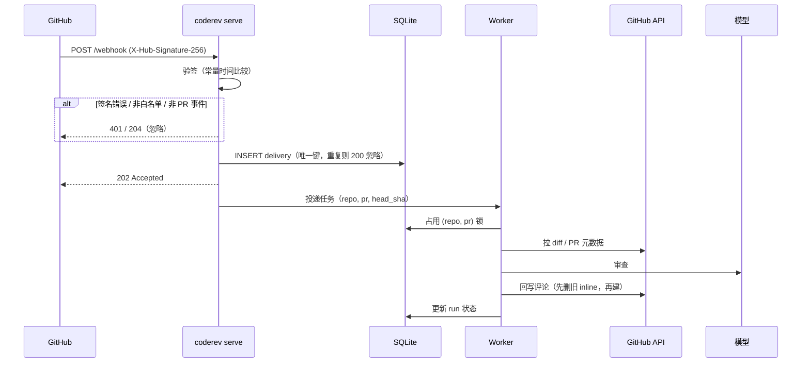

# Webhook 常驻服务设计（v0.3 #3）

> 一句话：把 `coderev serve` 从"只有健康检查"扩成"能收 GitHub webhook、异步跑审查、把结果写回 PR"的服务，**复用现有 CLI 的全部审查逻辑**。

---

## 1. 范围

**做**

- 接收 GitHub webhook，HMAC 验签
- 事件过滤（只处理 PR 相关，忽略 draft）
- 去重（同一 delivery、同一 PR 同一 commit 只审一次）
- 异步执行审查，立即返回 202
- 回写摘要评论 + inline 评论（复用 `publish.py`）
- 健康检查、结构化日志、运行记录

**不做**

- 多租户 / 账号体系 / 计费
- 前端 UI
- GitHub App 安装流程（v0.4）
- 外部队列（Redis / RabbitMQ）——单实例够用
- GitLab / Gitee

---

## 2. 关键决策

| 决策 | 选择 | 理由 |
|---|---|---|
| 同步还是异步 | **异步** | GitHub webhook 要求 10 秒内响应；一次审查要 10–40 秒 |
| 持久化 | **SQLite（stdlib）** | 零依赖、单文件、够存 delivery 与运行记录；不引 Postgres |
| 认证 | **PAT（`GITHUB_TOKEN`）** | 自托管最简单；GitHub App 放 v0.4 |
| diff 来源 | **调 API 拉取** | payload 只有元数据；也不信任 payload 里的内容 |
| 并发 | **同一 PR 串行** | 幂等发布是"先删后建"，并发会互相踩 |
| 部署形态 | **单实例** | 多实例需要分布式锁，v0.3 不做 |

---

## 3. 组件

```
src/coderev/
├── server.py     HTTP 层：路由、限流、响应（已有 /healthz /readyz）
├── webhook.py    验签 + 事件解析 + 过滤（纯函数，最容易测）
├── store.py      SQLite：deliveries、runs
├── worker.py     线程池 + 重试 + 同 PR 串行
├── service.py    review_pr()：从 cli.cmd_pr 抽出来的业务逻辑
└── cli.py        serve 子命令把上面串起来
```

**复用边界**：`service.review_pr()` 里只做「拉 diff → 解析 → 规则匹配 → 模型 → 守卫 → 发布」，与 CLI 完全一致。CLI 的 `pr` 子命令改成调用它，服务端也调用它——**只有一份实现**。

---

## 4. 请求流程



---

## 5. 路由

| 方法 | 路径 | 说明 | 鉴权 |
|---|---|---|---|
| POST | `/webhook` | GitHub 回调 | HMAC |
| GET | `/healthz` | 存活 | 无 |
| GET | `/readyz` | 就绪（含 DB 可写） | 无 |
| GET | `/runs/<id>` | 单次运行状态（可选，便于排错） | 无（不含敏感信息） |

---

## 6. 安全边界

| 项 | 做法 |
|---|---|
| 验签 | `X-Hub-Signature-256` = `sha256=` + HMAC-SHA256(secret, body)，`hmac.compare_digest` 比较 |
| 请求体大小 | 上限 1 MiB，超出 413 |
| 仓库白名单 | `CODEREV_REPOS=owner/a,owner/b`；不在名单直接 204，不落库 |
| 密钥来源 | `CODEREV_WEBHOOK_SECRET`、`GITHUB_TOKEN` 只从环境变量读，不写文件、不打日志 |
| 代码执行 | 审查进程**只读 diff**，不执行仓库代码（与 CLI 一致） |
| 日志脱敏 | 不打印 token、签名、payload 全文；只记 delivery id、repo、PR 号、结果 |
| 重放 | delivery id 唯一 + 校验 `X-GitHub-Delivery` 存在 |

> 明确不做的：IP 白名单（GitHub 的 hook IP 段会变，维护成本高）；签名已经能证明来源。

---

## 7. 幂等与并发

三层去重，从粗到细：

1. **delivery 层**：`X-GitHub-Delivery` 作为主键，重复投递直接返回 200。
2. **commit 层**：`(repo, pr_number, head_sha)` 已有成功记录 → 跳过（GitHub 会因 force-push 重复推送）。
3. **PR 层锁**：同一个 `(repo, pr_number)` 同时只允许一个任务在跑，后来的排队或丢弃（取最新 commit）。

实现：SQLite 唯一索引 + 进程内 `threading.Lock` 表。单实例下足够。

---

## 8. 失败与重试

- 收件立即 202，审查在后台跑。
- 失败写 `runs.status='failed'` 并记 `error`。
- 重试策略：网络类 / 5xx 重试 **1 次**（退避 5s）；401/403/422 不重试。
- 连续失败不要静默：日志 `ERROR` + `/readyz` 仍为 ok（避免编排层重启服务）。

---

## 9. 配置

| 变量 | 必填 | 说明 |
|---|---|---|
| `CODEREV_WEBHOOK_SECRET` | 是 | 与 GitHub webhook 里配的一致 |
| `GITHUB_TOKEN` | 是 | 回写评论用，需要 `pull-requests: write` |
| `CODEREV_REPOS` | 是 | 白名单，逗号分隔 |
| `CODEREV_DB` | 否 | 默认 `data/coderev.db` |
| `CODEREV_WORKERS` | 否 | 工作线程数，默认 2 |
| `CODEREV_API_KEY` 等 | 是 | 沿用现有模型配置 |

---

## 10. 可观测性

- 日志一行一条：`{"ts","event","delivery","repo","pr","status","ms"}`。
- `runs` 表字段：`id, delivery, repo, pr, head_sha, status, started_at, finished_at, error, findings, gaps`。
- `/runs/<id>` 返回状态与计数，不返回 diff 与模型原文。

---

## 11. 测试策略

| 层 | 用例 |
|---|---|
| 验签 | 正确签名 / 错误签名 / 缺头 / 算法不对 |
| 过滤 | 非 PR 事件、draft PR、非白名单仓库、缺 action 字段 |
| 幂等 | 重复 delivery、同 commit 重复、并发同 PR |
| 解析 | 用 GitHub 官方示例 payload 当 fixture |
| 集成 | fake transport 跑完整流程，断言评论请求发出 |

目标：**不连网、不连 GitHub、不调模型**也能覆盖 90% 分支。

---

## 12. 拆分（建议 3 个 PR）

| PR | 内容 | 验收 |
|---|---|---|
| 1 | `webhook.py` 验签 + 过滤 + `store.py` + 测试 | 单测覆盖验签与过滤；`/webhook` 对错误签名返回 401 |
| 2 | `service.py` 抽取 + `worker.py` 异步 + 去重 | 重复 delivery 只跑一次；同 PR 不并发 |
| 3 | compose 增加服务、部署文档、用 cloudflared 的本地联调说明 | 真实仓库装上 webhook 后能自动评论 |

---

## 13. 未决问题

1. **GitHub App（v0.4）**：需要私钥管理与 installation token 刷新，比 PAT 复杂但更安全（权限可收敛到单仓）。v0.3 先用 PAT。
2. **多实例**：SQLite 锁只在单进程有效。真要水平扩展，得换 Postgres 行锁或 Redis——留到有需求再说。
3. **大 PR**：超过 1500 行变更时是否只审高风险文件（PRD 里有这条），服务端要不要单独限流？
4. **仓库白名单变更**：改环境变量要重启容器。是否支持从 `.coderev.yml` 读（需要能访问仓库文件，多一次 API 调用）？
